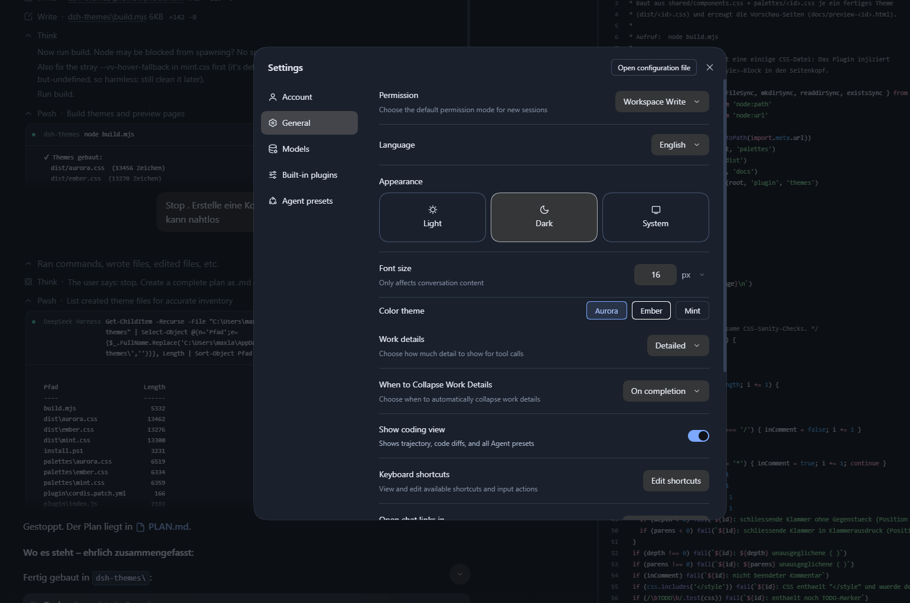
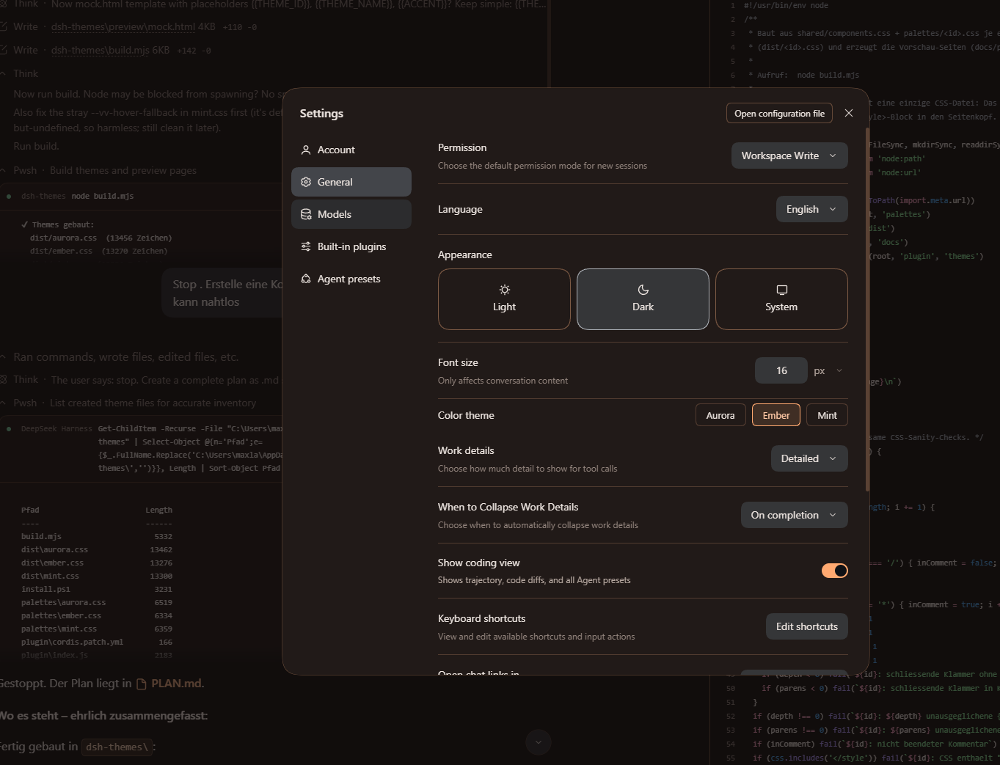
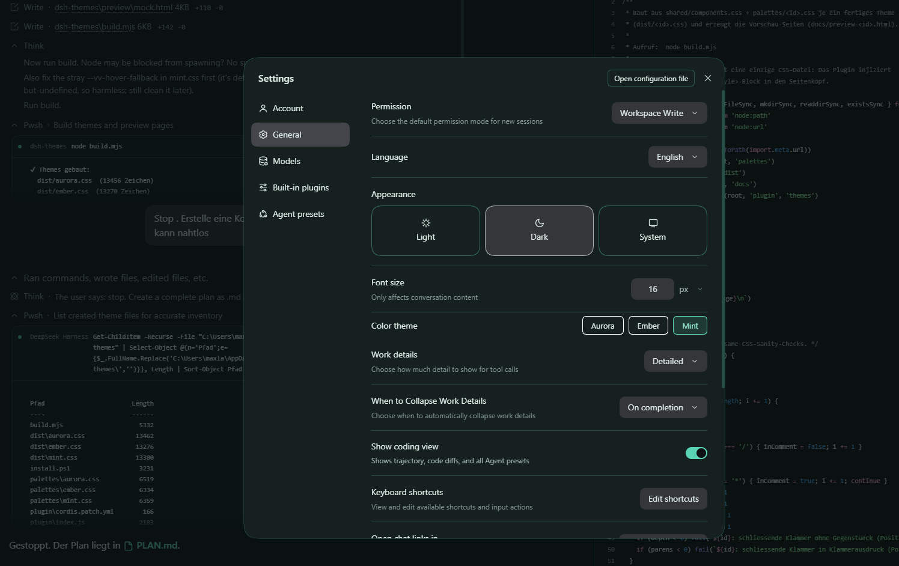

# dsh-theme-vivid

[](https://www.npmjs.com/package/dsh-theme-vivid)
[](LICENSE)
[](https://github.com/deepseek-ai/deepseek-harness)
[](https://PHSchr3ck3.github.io/dsh-theme-vivid/)

Colour themes for [DeepSeek Harness](https://github.com/deepseek-ai/deepseek-harness) (DSH):
twelve palettes, each with a light and a dark variant — from calm blues and
muted greens to a pure-black OLED variant.

The themes are pure token overrides. Nothing in the harness is patched: the host half
listens to `webserver/index-inject` and adds one `<style>` block to the page head, the
client half adds a *Color theme* row under **Settings > General**.

## Overview

| | |
|---|---|
| Package | [`dsh-theme-vivid`](https://www.npmjs.com/package/dsh-theme-vivid) on npm |
| Version | 1.1.0 |
| Install | `npm install --prefix "<profile>" dsh-theme-vivid` |
| Palettes | `aurora`, `ember`, `mint`, `sakura`, `iris`, `slate`, `moss`, `crimson`, `arctic`, `voltage`, `sand`, `noir` — each light and dark |
| Host hook | `webserver/index-inject`, one `<style>` line, no harness patches |
| Settings row | **Settings > General > Color theme** |
| DSH | `>=0.2.1-rc.5 <0.3.0` |
| License | MIT |
| Preview | https://PHSchr3ck3.github.io/dsh-theme-vivid/ |

## Palettes

| Id | Mood | Notes |
|---|---|---|
| `aurora` | cool, blue-violet | default |
| `ember` | warm amber | low blue light |
| `mint` | teal/green | calm, high legibility |
| `sakura` | rose/plum | soft, low glare |
| `iris` | violet | focused, distinct from Aurora |
| `slate` | graphite/steel | near-monochrome, minimal |
| `moss` | forest green/olive | natural, muted, easy on the eyes |
| `crimson` | garnet red | bold accent, warm dark surfaces |
| `arctic` | ice cyan | crisp, high contrast |
| `voltage` | neon magenta + cyan | high energy, synth mood |
| `sand` | parchment/clay | warm and desaturated, no blue |
| `noir` | pure black + silver | OLED-friendly, almost no colour |

Every palette ships light and dark values and follows the system appearance.

Live preview: https://PHSchr3ck3.github.io/dsh-theme-vivid/

## Screenshots

The *Color theme* row in **Settings > General**, switched through the palettes:

**Aurora**



**Ember**



**Mint**



### Alle Paletten

Each palette also has a rendered pair of shots (dark and light) and a
**Prüfblatt** test sheet that shows every token group on one page:

```
docs/shots/preview-<id>.png        dark
docs/shots/preview-<id>-hell.png   light
docs/test-<id>.html                test sheet
```

The overview page links both next to each palette.

## Install

### From npm

```powershell
npm install --prefix "<profile>" dsh-theme-vivid
```

The package ships its own `cordis.patch.yml`, so the DSH plugin manager picks it up
without further steps. **Restart the app afterwards:** the desktop profile collects its
injection table once at boot, reloading the window is not enough.

All twelve palettes can also be exported without touching a profile:

```powershell
npx dsh-theme-vivid list              # ids ausgeben
npx dsh-theme-vivid export .\themes  # alle CSS-Dateien kopieren
```

### From the release tarball

No registry account needed. Download the packed plugin and install it locally:

```powershell
curl.exe -L -o dsh-theme-vivid-1.1.0.tgz https://github.com/PHSchr3ck3/dsh-theme-vivid/releases/download/v1.1.0/dsh-theme-vivid-1.1.0.tgz
npm install --prefix "<profile>" .\dsh-theme-vivid-1.1.0.tgz
```

Recent npm versions refuse to fetch a remote URL directly (`EALLOWREMOTE`), so the
tarball has to be on disk first. Afterwards add the patch entry by hand or run
`..\install.ps1 -Theme aurora`, which copies the palette and writes the entry for you.

### Manual, per profile

```powershell
.\install.ps1 -Theme aurora
```

The script copies the plugin into `<profile>\node_modules\dsh-theme-vivid`, drops the
selected palette next to it as `theme.css` and appends the patch entry to
`cordis.patch.yml` (with a timestamped backup).

**Restart the app afterwards.** The desktop profile collects its injection table once
at boot; reloading the window is not enough.

## Configuration

| Key | Meaning |
|---|---|
| `theme` | `aurora` (default), `ember`, `mint`, `sakura`, `iris`, `slate`, `moss`, `crimson`, `arctic`, `voltage`, `sand`, `noir` |
| `cssPath` | path to a custom CSS file; wins over `theme` |

`DSH_VIVID_CSS` (environment variable) wins over both.

The palette can also be switched at runtime from **Settings > General > Color theme**;
the choice is stored in `localStorage` under `dsh-theme-vivid.palette`.

## Uninstall

```powershell
.\uninstall.ps1
```

Removes the plugin folder and the patch entry, keeping a backup of `cordis.patch.yml`.

## Layout

```
plugin/          host half (index.js), client bundle (client.js), palettes, patch
client/          source template of the client bundle
palettes/        palette sources
shared/          shared component rules
dist/            built CSS, one file per palette
docs/            preview pages, test sheets (test-<id>.html), screenshots
build.mjs        builds dist/, plugin/themes/, plugin/client.js and the Pages preview
verify.mjs       checks: single style line, token coverage, fallbacks
```

## Development

```bash
node build.mjs     # rebuild dist/, plugin/themes/, plugin/client.js and docs/
node verify.mjs    # run the checks
```

## Compatibility

DSH `0.2.1-rc.5` (engine range `>=0.2.1-rc.5 <0.3.0`). Windows, macOS and Linux;
the plugin only touches the documented `--dsw-*` tokens.

## License

MIT
